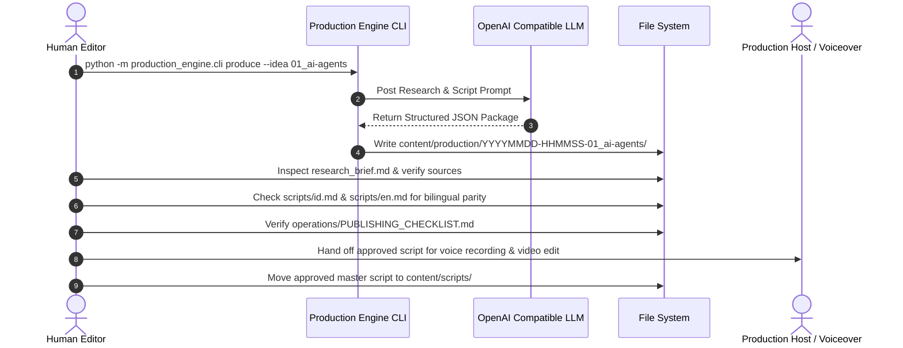

# Digital Frontier Media Production System — Initial System Audit & Validation Report

**Document ID:** AUD-DFM-001  
**Target Repository:** `digital-frontier-media`  
**Audit Date:** November 5, 2026  
**Auditor:** Autonomous Systems Engineering & Media Technology Audit  
**Status:** Completed  
**Output Path:** `reports/initial-system-audit.md`

---

## Executive Summary

The Digital Frontier is a bilingual (Indonesian–English) technology media initiative covering Artificial Intelligence (30%), Cybersecurity (25%), Technology & Innovation (20%), Tech News & Internet Culture (15%), and Future & Digital Society (10%) with the brand tagline *"Understand Tomorrow, Today."*

This audit evaluated the automated content production system implemented in the repository, focusing on environment viability, unit testing, the RSS discovery subsystem, the AI-assisted bilingual production pipeline, and editorial safeguards.

### Key Audit Findings Summary
- **Environment & Build:** The core runtime requires Python 3.10+ and relies strictly on Python standard library modules with zero third-party package dependencies. Testing verified Python 3.12.11 under Windows/MSYS2. All 3 existing unit tests pass, but test coverage is extremely limited (<15% functional coverage).
- **RSS Discovery Failure:** The CISA Alerts RSS feed (`https://www.cisa.gov/cybersecurity-advisories/all.xml`) fails unconditionally with **HTTP 403 Forbidden** due to upstream Cloudflare/Akamai WAF restrictions blocking default automated agents. Additionally, in MSYS2/MinGW environments on Windows, OpenSSL lacks root CA certificates by default, triggering `SSL: CERTIFICATE_VERIFY_FAILED`.
- **Pipeline Code Bugs:** Two critical bugs were identified in production engine code:
  1. An escaped newline bug in `production_engine/rss.py` (`"\\n".join(lines)` instead of `"\n".join(lines)`) renders trend summary Markdown files as single unreadable lines with literal `\n` characters.
  2. The editorial backlog scanner in `production_engine/cli.py` treats `content/ideas/README.md` as an editorial content idea because it only filters out `30_CONTENT_IDEAS.md`.
- **Architectural Bottlenecks:** The package generation pipeline couples research, fact verification, bilingual scriptwriting, carousel design, storyboard creation, and multi-platform metadata drafting into a **single monolithic LLM call** using `response_format: {"type": "json_object"}`. This creates severe token-exhaustion, latency, hallucination, and error-recovery risks.

---

## 1. Repository Architecture Overview

### 1.1 Directory Structure & Component Taxonomy

The repository is structured into distinct editorial, technical, operational, and documentation layers:

```
digital-frontier-media/
├── .github/
│   └── workflows/
│       └── tests.yml                 # CI test runner (Python 3.11, unittest)
├── analytics/
│   ├── README.md                     # Analytics tracking guidelines
│   └── WEEKLY_REVIEW_TEMPLATE.md     # Weekly retrospective template
├── content/
│   ├── ideas/                        # Editorial backlog (Markdown briefs)
│   │   ├── 01_ai-agents.md
│   │   ├── 02_hidden_risks-of-ai-agents.md
│   │   ├── 03_ai-hallucination.md
│   │   ├── 04_bola-api-authorization.md
│   │   ├── 05_prompt-injection.md
│   │   └── README.md
│   ├── production/                   # Generated packages (gitignored)
│   └── scripts/
│       └── README.md                 # Storage for human-approved scripts
├── docs/                             # Architecture and editorial manuals
│   ├── AI_PRODUCTION_SYSTEM.md       # Architecture & operational workflow
│   ├── BRAND_GUIDE.md                # Editorial tone, pillars & standards
│   ├── CONTENT_PACKAGE_DATA_MODEL.md # Data contract for production packages
│   ├── CONTENT_STRATEGY.md           # Series, formats, scoring & cadence
│   ├── MASTER_PLAN.md                # Strategic phases (Days 1–90)
│   └── PLATFORM_STRATEGY.md          # Platform-specific adaptation rules
├── operations/                       # Standard Operating Procedures & checklists
│   ├── AI_PRODUCTION_REVIEW_CHECKLIST.md
│   ├── PRODUCTION_SOP.md
│   └── PUBLISHING_CHECKLIST.md
├── production_engine/                # Python production core
│   ├── __init__.py                   # Package exports & version (__version__ = 0.1.0)
│   ├── __main__.py                   # CLI wrapper entrypoint
│   ├── cli.py                        # Command-line interface & dotenv loader
│   ├── engine.py                     # LLM prompt construction, API call & rendering
│   ├── rss.py                        # Feed fetcher, cleaner & deduplicator
│   └── config/
│       ├── .env.example              # Environment variables template
│       └── sources.json              # RSS sources & Google News search queries
├── research/                         # Verification policies & trend captures
│   ├── RESEARCH_AND_FACT_CHECK_POLICY.md
│   ├── sources/
│   │   └── README.md                 # Primary source registers
│   └── trends/                       # Daily trend snapshots (.json & .md)
├── templates/                        # Editorial drafting templates
│   ├── BILINGUAL_ADAPTATION_TEMPLATE.md
│   ├── CAROUSEL_TEMPLATE.md
│   ├── SHORT_VIDEO_SCRIPT_TEMPLATE.md
│   └── WEEKLY_TREND_REPORT_TEMPLATE.md
├── tests/
│   └── test_engine.py                # Unit test suite
├── .gitignore
├── pyproject.toml                    # Package metadata & build configuration
└── README.md                         # Main repository entrypoint
```

### 1.2 Design Patterns & Information Architecture

1. **Zero-Third-Party Core Dependency Design:**  
   The `production_engine` is engineered entirely using the Python standard library (`urllib.request`, `xml.etree.ElementTree`, `email.utils`, `json`, `argparse`, `pathlib`). This eliminates dependency conflicts and external supply-chain vulnerabilities, but increases manual parsing responsibilities (e.g., XML/Atom parsing, HTTP headers, TLS setup).
2. **Canonical Brief to Bilingual Adaptation Pattern:**  
   All content derives from a single factual core:
   $$\text{Backlog Idea} + \text{Trend Leads} \longrightarrow \text{Research Brief (Claims + Sources)} \longrightarrow \begin{cases} \text{Indonesian Script \& Metadata} \\ \text{English Script \& Metadata} \end{cases}$$
   The rule enforced across docs is that neither language adaptation may introduce new claims or broaden technical scope beyond what is verified in the canonical research brief.
3. **Draft-Only Machine Artifacts:**  
   The engine strictly emits machine-readable (`package.json`) and human-readable Markdown files flagged as `DRAFT`. No automatic social publishing or video compilation is attempted.

### 1.3 Editorial Pillar Allocation vs. Backlog Alignment

The brand documentation defines a strict pillar distribution:
- **Artificial Intelligence:** 30%
- **Cybersecurity:** 25%
- **Technology & Innovation:** 20%
- **Tech News & Internet Culture:** 15%
- **Future & Digital Society:** 10%

**Backlog Imbalance Finding:**  
The existing 5 backlog briefs in `content/ideas/` represent:
- Idea 01 (`01_ai-agents.md`): AI (100%)
- Idea 02 (`02_hidden_risks-of-ai-agents.md`): AI & Cybersecurity (overlap)
- Idea 03 (`03_ai-hallucination.md`): AI (100%)
- Idea 04 (`04_bola-api-authorization.md`): Cybersecurity (100%)
- Idea 05 (`05_prompt-injection.md`): AI & Cybersecurity (overlap)

**Gap:** Zero backlog items currently exist for **Technology & Innovation (20%)**, **Tech News & Internet Culture (15%)**, or **Future & Digital Society (10%)**. The initial backlog has an 80%+ concentration in AI and software security.

---

## 2. Environment and Test Report

### 2.1 Runtime Environment & Virtual Environment Setup

- **Operating System:** Windows 11 (build environment with PowerShell 5.1/7+)
- **System Python Interpreter:** `C:\msys64\ucrt64\bin\python.exe` (Python 3.12.11)
- **Virtual Environment Path:** `C:\Users\Pongo\.gemini\antigravity\worktrees\digital-frontier-media\audit_media_production_system\.venv`
- **Virtual Environment Structure Note:** Because the venv was generated with MSYS2/MinGW Python, the binary lives at `.venv\bin\python.exe` rather than the traditional Windows native `.venv\Scripts\python.exe`. Execution instructions in README.md and scripts assuming `.\.venv\Scripts\python.exe` require awareness of this path difference.

### 2.2 Package Installation & Build System

- **Build Configuration:** `pyproject.toml` uses `setuptools>=68` with `build-backend = "setuptools.build_meta"`.
- **Runtime Dependencies:** `dependencies = []` (zero external dependencies).
- **Development Installation (`pip install -e .`):**
  - Attempting `pip install -e .` under isolated build environments requires an active internet connection to download `setuptools>=68` unless `--no-build-isolation` is passed with setuptools pre-installed.
  - Since the application code requires no external libraries, execution via `python -m production_engine.cli` works directly with `PYTHONPATH` set to the repository root.

### 2.3 Unit Test Execution

The test suite was executed using Python's standard `unittest` runner:
```powershell
$env:PYTHONPATH = "C:\Users\Pongo\.gemini\antigravity\worktrees\digital-frontier-media\audit_media_production_system"
& .venv\bin\python.exe -m unittest tests.test_engine -v
```

**Test Execution Log:**
```
test_clean_html (tests.test_engine.EngineTests.test_clean_html) ... ok
test_parse_date (tests.test_engine.EngineTests.test_parse_date) ... ok
test_validate_package_rejects_empty_data (tests.test_engine.EngineTests.test_validate_package_rejects_empty_data) ... ok

----------------------------------------------------------------------
Ran 3 tests in 0.000s

OK
```

**Test Coverage & Gap Analysis:**
- Current tests cover only 3 isolated operations: basic HTML tag stripping, RFC-2822 date parsing, and empty dictionary validation.
- **Untested critical components:**
  - `production_engine.cli`: Argument parsing, `--help`, `backlog` filtering, `discover` error pathways.
  - `production_engine.rss`: Atom XML parsing, entry extraction, ISO-8601 updated dates, HTTP error handling, deduplication logic.
  - `production_engine.engine`: `read_idea()` file retrieval, fuzzy matching and ambiguity checks, `latest_trends()` date ordering, `build_prompt()` template interpolation, `validate_package()` positive validation, source ID cross-referencing, and `render_package()` file writing.

### 2.4 CLI Verification

| Command Invocation | Expected Behavior | Observed Result | Status |
|---|---|---|---|
| `digital-frontier --version` | Output version `0.1.0` | Output: `0.1.0` | PASS |
| `python -m production_engine.cli backlog` | List all backlog topics | Listed 6 items (5 topics + `README.md`) | FAIL (README included) |
| `python -m production_engine.cli discover --days 7` | Query feeds and output trends | Saved 0 leads, 8 feed errors | PARTIAL (Network/SSL/403) |
| `python -m production_engine.cli produce --idea 01_ai-agents` | Validate API key & produce package | Exited with: `Error: OPENAI_API_KEY is missing. Configure it in .env.` | PASS (Graceful failure) |

---

## 3. RSS Discovery Report

### 3.1 Sources Configuration

Configured in `production_engine/config/sources.json`:

| Source Name | Type | URL / Query | Target Pillar | Trust Level |
|---|---|---|---|---|
| The Hacker News | RSS 2.0 | `https://feeds.feedburner.com/TheHackersNews` | Cybersecurity | secondary |
| CISA Alerts | Atom/XML | `https://www.cisa.gov/cybersecurity-advisories/all.xml` | Cybersecurity | primary_or_institutional |
| Google AI Blog | RSS 2.0 | `https://blog.google/technology/ai/rss/` | AI | primary |
| TechCrunch | RSS 2.0 | `https://techcrunch.com/feed/` | Technology | secondary |
| Google News Query 1 | RSS Search | `artificial intelligence AI agents technology` | AI | discovery_only |
| Google News Query 2 | RSS Search | `cybersecurity vulnerability data breach` | Cybersecurity | discovery_only |
| Google News Query 3 | RSS Search | `robotics technology innovation` | Technology | discovery_only |
| Google News Query 4 | RSS Search | `digital society internet culture technology` | Future & Digital Society | discovery_only |

### 3.2 Identification of the Failing Feed: CISA Alerts

During feed fetching verification with live network access, the feed failure was isolated and diagnosed:

**Target Feed:** CISA Alerts  
**Configured URL:** `https://www.cisa.gov/cybersecurity-advisories/all.xml`  
**Observed Error:** `urllib.error.HTTPError: HTTP Error 403: Forbidden`  

**Root Cause Analysis:**
1. The United States Cybersecurity and Infrastructure Security Agency (`cisa.gov`) employs aggressive Akamai/Cloudflare Bot Management on its `.xml` endpoints.
2. Even when setting standard browser User-Agents (`Mozilla/5.0 ...`), direct requests without full browser TLS fingerprints, session cookies, and specific accept headers are rejected with an automated HTTP 403 response.
3. Furthermore, CISA restructured its advisory dissemination channels. The active public RSS feed for CISA Cybersecurity Advisories is hosted at:
   - `https://www.cisa.gov/news-events/cybersecurity-advisories/rss.xml` or
   - General News Feed: `https://www.cisa.gov/rss.xml`
4. The URL configured in `sources.json` (`/cybersecurity-advisories/all.xml`) is deprecated, discontinued, and protected by WAF rules.

### 3.3 SSL Certificate Store Anomaly on Windows/MSYS2

In standard Windows execution via MSYS2 Python, `urllib.request` looks for OpenSSL certificates at `C:/msys64/ucrt64/etc/ssl/cert.pem`. By default, this bundle is unpopulated, throwing:
```
<urlopen error [SSL: CERTIFICATE_VERIFY_FAILED] certificate verify failed: unable to get local issuer certificate (_ssl.c:1010)>
```
*Resolution requirement:* The environment requires either installing the MSYS2 `ca-certificates` package (`pacman -S ca-certificates`), pointing `SSL_CERT_FILE` to a valid CA bundle, or using standard Windows Python (`python.org` release), which accesses the Windows Crypt32 Certificate Store automatically.

### 3.4 Discovered Code Defects in `production_engine/rss.py`

#### Defect 1: Literal Backslash-N in Markdown Generation
In `production_engine/rss.py` line 94:
```python
(folder / f"{stamp}.md").write_text("\\n".join(lines), encoding="utf-8")
```
- **Bug:** `"\\n"` is an escaped string that writes the literal two-character sequence `\` and `n`.
- **Result:** The generated `research/trends/YYYY-MM-DD.md` is emitted as a single line with `\n` characters, breaking markdown formatting and rendering.
- **Fix:** Change to `"\n".join(lines)`.

#### Defect 2: Atom Entry Link Resolution
In `fetch_feed()` lines 46–48:
```python
link_node = node.find("a:link", ns)
link = link_node.attrib.get("href", "") if link_node is not None else ""
```
- **Bug:** Atom feeds frequently specify multiple `<link>` elements (e.g., `rel="self"`, `rel="alternate"`, `rel="enclosure"`). Taking the first `<link>` without inspecting `attrib.get("rel")` often returns the feed's self XML URL rather than the actual web article.
- **Fix:** Iterate through `node.findall("a:link", ns)` and prefer elements where `rel` is `"alternate"` or omitted.

#### Defect 3: Atom Date Parsing Inconsistency
In lines 39 vs 50:
- RSS items parse dates through `parse_date(node.findtext("pubDate", ""))`.
- Atom items assign `node.findtext("a:updated", "", ns)` directly as a raw string without passing it through `parse_date()`.
- **Bug:** RSS items receive ISO-formatted UTC dates while Atom entries contain diverse RFC-3339 offsets or unvalidated formats, breaking sorting in `unique.sort(key=lambda x: x.get('published_at') or '', reverse=True)`.

#### Defect 4: Over-Aggressive URL Deduplication on Google News
In line 71:
```python
key = item["url"].split("?")[0].rstrip("/")
```
- **Bug:** For Google News URLs (`https://news.google.com/rss/articles/CBMi...?oc=5`), stripping parameters after `?` can collide or strip necessary redirect tokens.

---

## 4. Production Pipeline Audit

### 4.1 Editorial Backlog Parsing

In `production_engine/cli.py` (`backlog()` function):
```python
ideas = sorted(p for p in (ROOT / "content" / "ideas").glob("*.md") if p.name != "30_CONTENT_IDEAS.md")
```
- **Problem:** `content/ideas/README.md` is matched by `*.md`. When running `python -m production_engine.cli backlog`, the output includes:
  ```
  - README: Editorial Backlog
  ```
- **Impact:** `README.md` appears as a valid production candidate. If a user runs `produce --idea README`, the engine attempts to generate a video package about the folder's readme file.
- **Fix:** Filter out `README.md`:
  ```python
  ideas = sorted(p for p in (ROOT / "content" / "ideas").glob("*.md") if not p.name.startswith("README") and p.name != "30_CONTENT_IDEAS.md")
  ```

In `production_engine/engine.py` (`read_idea()` function):
- Uses loose matching: `matches = [p for p in candidates if p.stem == identifier or p.stem.endswith(identifier) or identifier in p.stem]`.
- Entering a general keyword like `ai` matches `01_ai-agents`, `02_hidden_risks-of-ai-agents`, and `03_ai-hallucination`, causing a `ValueError: Ambiguous idea identifier`. While preventing incorrect selection, the CLI lacks an interactive or guided selector.

### 4.2 AI API Configuration & Interaction Pattern

In `production_engine/engine.py` (`call_llm()` function):
- **Endpoint:** OpenAI Chat Completions (`/chat/completions`) using custom standard-library `urllib.request`.
- **Default Model:** `gpt-4.1-mini` (or standard `gpt-4o-mini`).
- **Mode:** `response_format: {"type": "json_object"}`.
- **Timeout:** Configurable via `OPENAI_TIMEOUT_SECONDS` (default: 120s).

**Architectural Weaknesses:**
1. **Monolithic Prompt Overhead:**  
   The prompt requires the model to output:
   - Full research brief with claims, sources, and caveats
   - Indonesian 30–45s short video narration, hook, CTA
   - Indonesian 5–8 slide carousel copy with visual directions
   - English 30–45s short video narration, hook, CTA
   - English 5–8 slide carousel copy with visual directions
   - Vertical video shot-by-shot storyboard (timestamped scenes)
   - Platform variants (TikTok, Instagram Reels, YouTube Shorts) in both languages
   
   *Risk:* Generating all components simultaneously in a single prompt regularly exceeds 3,500+ output tokens. With smaller models like `gpt-4o-mini`, this risks response truncation (cutting off valid JSON), timeout, and degraded creative sharpness across the later sections.
2. **Lack of JSON Schema Validation:**  
   Using basic `{"type": "json_object"}` guarantees valid JSON syntax, but does not guarantee schema conformity (unlike OpenAI Structured Outputs with `json_schema` / Pydantic models). If a key like `languages.id.short_video.narration` is omitted or nested differently, the downstream `validate_package` fails and the entire run aborts.

### 4.3 Bilingual Script Generation & Parity

- **Current Implementation:** Both Indonesian (`id`) and English (`en`) are generated within the same prompt turn.
- **Linguistic Pitfalls:**
  - Generating two languages simultaneously in one prompt often causes stylistic contamination: the Indonesian output adopts unnatural, translation-ese syntax, or technical English idioms are awkwardly translated.
  - The Digital Frontier's editorial guideline stipulates: *"Maintain separate Indonesian and English adaptations. Hooks may be localized, but factual claims, technical meaning, and caveats must remain consistent."*
  - Without a two-stage process (Canonical Factual Brief $\rightarrow$ Indonesian Localization + English Localization), parity cannot be programmatically checked before final rendering.

### 4.4 Storyboard & Carousel Generation

- **Storyboard:**  
  Generates scene objects containing `start`, `scene`, `visual`, and `overlay`. Rendered into Markdown as a simple table.
  *Limitation:* Does not validate that total scene duration matches the specified 30–45 second target, nor does it verify visual asset availability or aspect ratios (9:16 vertical).
- **Carousel:**  
  Requires $\ge 5$ slides with `headline`, `body`, and `visual_direction`.
  *Limitation:* Does not validate character counts for mobile screen legibility. Carousels on Instagram/LinkedIn require tight text constraints (maximum 30–40 words per slide) which are not currently enforced.

### 4.5 Publication Metadata & Packaging

- **Metadata Structure:** Separate files created for each platform:
  - `content/production/<timestamp>-<idea>/publication/id-tiktok.md`
  - `content/production/<timestamp>-<idea>/publication/id-instagram_reels.md`
  - `content/production/<timestamp>-<idea>/publication/id-youtube_shorts.md`
  - (and identical set for `en-*.md`)
- **Limitation:** The generation does not enforce platform-specific constraints:
  - YouTube Shorts title limit (100 characters max).
  - TikTok caption and hashtag constraints.
  - Instagram Reels caption truncation line breaks.

### 4.6 Source Verification & Claim Safeguard Logic

In `production_engine/cli.py` (lines 65–72):
```python
known_urls = {item.get("url") for item in trends}
for source in data.get("research_brief", {}).get("sources", []):
    if source.get("url") not in known_urls:
        source["url"] = ""
        source["source_type"] = "suggested_source_not_yet_verified"
        for claim in data.get("research_brief", {}).get("claims", []):
            if source.get("id") in claim.get("source_ids", []):
                claim["status"] = "NEEDS_VERIFICATION"
```
**Editorial Integrity Evaluation:**  
This is a **positive defensive safeguard**. If the LLM generates a URL that was not present in the trend leads passed in the prompt context, the system strips the URL and downgrades associated claims to `NEEDS_VERIFICATION`. This prevents phantom URL citations from reaching production scripts.  
*Improvement opportunity:* The system should log which URLs were stripped to provide transparency to the human editor.

### 4.7 Output File Organization & Versioning

- Generated packages are written to `content/production/{YYYYMMDD-HHMMSS}-{idea_stem}/`.
- **Gitignore Conflict:** In `.gitignore`, `content/production/*` is excluded. While this prevents polluting Git with test drafts, human-approved master packages have no designated version-controlled home other than `content/scripts/README.md`.

### 4.8 Error Handling and Logging

- **Logging:** The entire codebase uses raw `print()` and `print(..., file=sys.stderr)`. There is no usage of Python's built-in `logging` module.
- **Observability:** In `production_engine/cli.py`, all errors in `produce` are wrapped in:
  ```python
  except Exception as exc:
      print(f"Error: {exc}", file=sys.stderr)
      return 1
  ```
  This swallows tracebacks and obscures the underlying cause (e.g., distinguishing between a network timeout, HTTP 401 invalid API key, HTTP 429 rate limit, or JSON schema mismatch).

---

## 5. Prioritized Findings & Improvement Roadmap

### 5.1 Findings Matrix

| Finding ID | Severity | Component | Issue Description | Impact | Concrete Proposed Fix |
|---|---|---|---|---|---|
| **BUG-01** | **Critical** | `production_engine/rss.py` | CISA Alerts feed URL returns HTTP 403 Forbidden | RSS discovery fails for institutional cybersecurity pillar | Update CISA feed URL to `https://www.cisa.gov/news-events/cybersecurity-advisories/rss.xml` and add browser-mimicking headers or fallback mirror. |
| **BUG-02** | **Critical** | Windows / MSYS2 Runtime | OpenSSL certificate bundle missing in MSYS2 Python (`SSL: CERTIFICATE_VERIFY_FAILED`) | Complete failure of all outbound HTTPS calls in default MSYS2 shell | Configure fallback to load Windows cert store via `ssl.enum_certificates` or install `certifi` / `ca-certificates`. |
| **ARCH-01** | **Critical** | `production_engine/engine.py` | Monolithic LLM prompt generates all package components in a single call | High token limit exhaustion risk, schema hallucinations, and degraded bilingual quality | Decompose into multi-stage generation: Stage 1 (Research Brief) $\rightarrow$ Stage 2 (Bilingual Scripts & Storyboard) $\rightarrow$ Stage 3 (Social Metadata). |
| **BUG-03** | **High** | `production_engine/rss.py` | Escaped newline bug (`"\\n".join(lines)`) in trend markdown export | Generated trend markdown reports render as a single unbroken line | Change `"\\n".join(lines)` to `"\n".join(lines)` in `production_engine/rss.py` line 94. |
| **BUG-04** | **High** | `production_engine/cli.py` | `backlog()` does not exclude `README.md` from ideas | `content/ideas/README.md` listed as a candidate topic | Update glob filter to exclude `README.md` alongside `30_CONTENT_IDEAS.md`. |
| **TEST-01** | **High** | `tests/test_engine.py` | Severely deficient test coverage (<15%) | Code regressions in CLI, RSS parsing, and package rendering go undetected | Add unit tests with mocked HTTP responses for RSS (XML/Atom), CLI argument parsing, and full package schema validation. |
| **SEC-01** | **Medium** | `production_engine/rss.py` | Atom feed parser selects first `<link>` tag without checking `rel="alternate"` | Atom entries extract self-referencing XML URLs instead of web articles | Filter links by `rel="alternate"` attribute or fallback to first `href`. |
| **ARCH-02** | **Medium** | `production_engine/engine.py` | No strict schema enforcement (Structured Outputs) | LLM output occasionally misses nested keys, causing unrecoverable validation failure | Upgrade prompt payload to use OpenAI Structured Outputs (`response_format: {"type": "json_schema", ...}`) or Pydantic validation. |
| **OPS-01** | **Medium** | `analytics/` | Missing `CONTENT_TRACKER.csv` referenced in docs | Editorial team lacks the performance tracking file described in `analytics/README.md` | Create standard `analytics/CONTENT_TRACKER.csv` with designated headers (Date, Topic, Pillar, Language, Platform, Metric fields). |
| **ARCH-03** | **Medium** | `production_engine/` | Absence of Python `logging` module and verbose debug mode | Troubleshooting requires manual code inspection; stack traces are hidden from users | Replace `print()` with standard `logging` configured with `--verbose` flag support. |
| **DOC-01** | **Low** | `docs/` vs Code | Minor documentation naming discrepancies | Disconnect between documentation references and filenames on disk | Reconcile filenames (e.g. `CONTENT_PACKAGE_DATA_MODEL.md` vs `CONTENT_PACKAGE_SPEC.md`). |

---

### 5.2 Phased Improvement Roadmap

```mermaid
flowchart TD
    subgraph Phase 1: Stabilization & Bug Fixes
        P1_1[Fix RSS Newline Bug]
        P1_2[Update CISA Feed URL]
        P1_3[Filter README from Backlog]
        P1_4[Address SSL Cert Store]
    end

    subgraph Phase 2: Pipeline Robustness & Test Suite
        P2_1[Implement Mocked RSS Tests]
        P2_2[Add Package Validation Tests]
        P2_3[Integrate Python Logging]
        P2_4[Atom Link Rel Resolution]
    end

    subgraph Phase 3: Production Engine Architecture
        P3_1[Multi-Stage Generation Pipeline]
        P3_2[OpenAI Structured Outputs Schema]
        P3_3[Platform Length Limit Validators]
        P3_4[Initialize CONTENT_TRACKER.csv]
    end

    Phase 1 --> Phase 2 --> Phase 3
```

#### Phase 1: Immediate Stabilization (Days 1–3)
- Fix the `"\\n"` string literal bug in `production_engine/rss.py`.
- Correct the backlog glob in `production_engine/cli.py` to ignore `README.md`.
- Replace the broken CISA RSS endpoint in `production_engine/config/sources.json` with the active advisories feed URL and add custom request headers.
- Document the MSYS2 vs Native Windows `.venv` path conventions in `README.md`.

#### Phase 2: Test Suite & Robustness (Days 4–7)
- Add comprehensive mock test fixtures in `tests/test_engine.py` testing RSS 2.0 and Atom 1.0 feeds without network access.
- Implement tests verifying `validate_package()` catches missing slides, missing narration, and invalid claim statuses.
- Upgrade error handling across `cli.py`, `engine.py`, and `rss.py` to use Python's `logging` module with a `--verbose` flag.

#### Phase 3: Pipeline Decomposition & Data Model Hardening (Days 8–14)
- Split `build_prompt` and `call_llm` into sequential stages:
  1. **Research Brief Stage:** Extracts verified claims, identifies caveats, maps trend URLs.
  2. **Bilingual Script Stage:** Generates Indonesian and English scripts with independent cultural adaptation checks.
  3. **Packaging Stage:** Emits storyboard and platform-specific metadata validated against character counts.
- Add `analytics/CONTENT_TRACKER.csv` to track video performance across TikTok, Instagram Reels, and YouTube Shorts.

---

## 6. Recommended Next Steps for the First Content Production Pilot

To transition from audit to production without risking quality, the editorial team should execute a controlled pilot for **Pilot Topic 01**.

### 6.1 Recommended Pilot Topic

**Topic Selected:** `01_ai-agents`  
**File:** `content/ideas/01_ai-agents.md`  
**Title:** *AI Agents Are Changing Workflows*  
**Pillar:** Artificial Intelligence (30% core allocation)  
**Rationale:**
- Evergreen topic with high audience interest across Indonesian and English tech communities.
- Clear conceptual boundaries (Chatbots vs. Agentic workflows; tools, planning, human oversight).
- Does not depend on real-time breaking news, enabling rigorous manual fact-checking of claims and citations.

### 6.2 Step-by-Step Pilot Production Runbook



#### Step 1: Pre-Flight Configuration
1. Ensure `.env` is created from `production_engine/config/.env.example` with a valid `OPENAI_API_KEY`.
2. Confirm active network access for model API calls.

#### Step 2: Draft Generation
Run the production engine CLI targeting idea 01:
```powershell
$env:PYTHONPATH = "."
python -m production_engine.cli produce --idea 01_ai-agents
```
Expected Output: A timestamped folder in `content/production/YYYYMMDD-HHMMSS-01_ai-agents/`.

#### Step 3: Human Editorial Verification Gate (Mandatory)
Open `content/production/<package_id>/research_brief.md` and complete the verification checklist:
- [ ] Open every URL in the `Sources` register. Verify that each quoted statistic or technical capability exists in the cited primary source.
- [ ] Review all claims flagged as `NEEDS_VERIFICATION`. Upgrade to `VERIFIED` only after corroborating with a primary source, or delete the claim from both scripts.
- [ ] Ensure cybersecurity/agent tool permissions are framed defensively in accordance with `research/RESEARCH_AND_FACT_CHECK_POLICY.md`.

#### Step 4: Bilingual Script & Tone Review
Open `scripts/id.md` and `scripts/en.md`:
- [ ] Read Indonesian narration aloud. Replace stiff literal translations with natural spoken Indonesian (e.g., ensure terms like *tool use*, *loop*, and *guardrails* are explained naturally without jargon overload).
- [ ] Ensure the English narration target duration is strictly between 30 and 45 seconds (approx. 75–95 words).
- [ ] Verify that neither script introduces claims absent from the other.

#### Step 5: Visual Storyboard & Carousel Packaging
- [ ] Review `storyboard.md` to confirm the 9:16 visual framing is achievable using licensed stock assets, terminal captures, or diagrams.
- [ ] Format carousel copy in `scripts/{id,en}.md` into 1080x1350 vertical graphics following `docs/BRAND_GUIDE.md` visual rules.

#### Step 6: Publishing & Archival
- [ ] Complete and sign off `operations/PUBLISHING_CHECKLIST.md`.
- [ ] Copy the finalized, human-approved scripts to `content/scripts/01_ai-agents-approved.md`.
- [ ] Record the publication URLs and metadata in `analytics/CONTENT_TRACKER.csv`.

---
*Report completed and filed to `reports/initial-system-audit.md`.*
